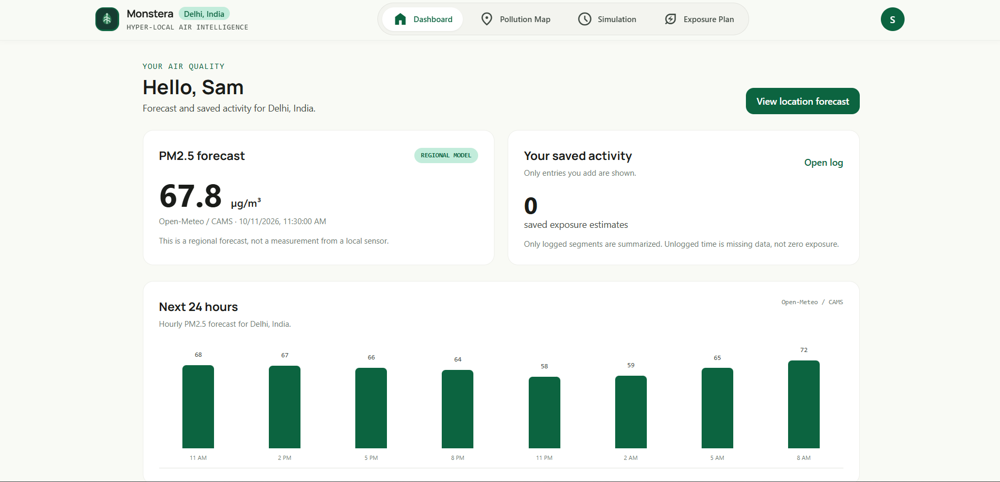
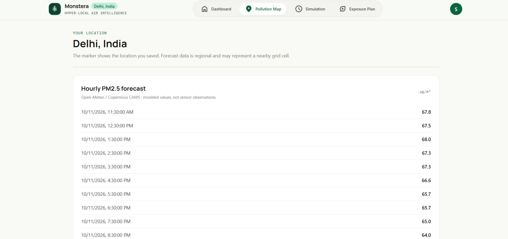
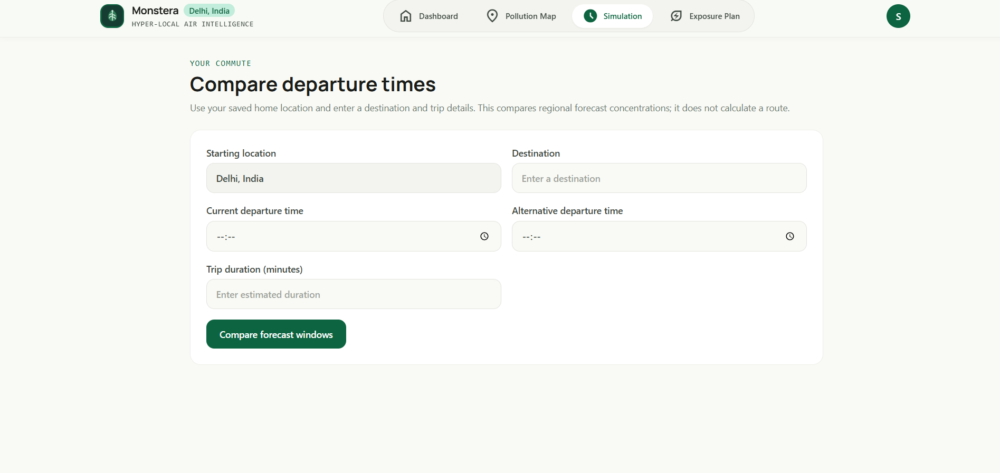

# Monstera 🌿
### Hyper-local air intelligence

Monstera helps people make more informed day-to-day decisions around air pollution. Instead of showing a pollution number without context, it brings a regional PM2.5 forecast, a saved location, exposure logging, and commute-time comparisons into one place.

Built for the hackathon with a practical goal: make air-quality information easier to understand and easier to use.

## Live deployment

**Backend: deployed on AWS Elastic Beanstalk**

- **AWS API:** http://monstera-env.eba-ua9xcq9e.ap-southeast-2.elasticbeanstalk.com
- **API documentation:** http://monstera-env.eba-ua9xcq9e.ap-southeast-2.elasticbeanstalk.com/docs
- **API health check:** http://monstera-env.eba-ua9xcq9e.ap-southeast-2.elasticbeanstalk.com/health

The FastAPI backend is running on AWS Elastic Beanstalk in the Sydney (`ap-southeast-2`) region. The `/docs` page exposes the interactive API documentation.

> The backend is deployed on AWS. The public frontend URL should be added here once the frontend hosting deployment is complete.

## The problem

Air pollution affects everyday choices, but a single city-level reading does not tell someone what conditions may look like later, how their planned activities fit into that picture, or how to compare the timing of a trip.

Monstera brings these pieces together in one workflow. It also makes the data limitation clear: a forecast is a model estimate, not a reading from a sensor at the user's exact location.

## What Monstera does

- **Personal onboarding:** create an account and save a home city or location.
- **PM2.5 forecast:** view hourly regional air-quality forecasts using Open-Meteo and Copernicus CAMS data.
- **Location view:** see the saved location and its forecast context on the pollution map.
- **Exposure log:** record activities and review saved exposure estimates.
- **Exposure planning:** review logged activity and use the planner to support day-to-day decisions.
- **Commute comparison:** compare forecast conditions for different departure times between a saved home location and a destination.
- **Saved routines and simulations:** keep useful commute comparisons for later.
- **Account-scoped data:** saved records belong to the signed-in account.

New accounts begin with an empty activity log. The forecast can still be viewed before there is saved activity.

## Screenshots

### Dashboard
The dashboard puts the current regional PM2.5 forecast, saved activity summary, and next-hours outlook in one view.



### Pollution map
The map page shows the user's saved location alongside the hourly forecast. Forecast values are regional model data and may represent a nearby grid cell.



### Commute simulation
The simulation page compares forecast windows for different departure times using a destination and estimated trip duration.



## How it works

```text
Browser
  |
  v
React + Vite frontend
  |
  v
Express web server / same-origin API proxy
  |  /api/v1/*
  v
FastAPI backend
  |
  +--> SQLAlchemy data models and Alembic migrations
  |
  +--> Open-Meteo geocoding and air-quality forecast APIs
```

The frontend's Express server serves the built React app and proxies `/api/v1` requests to FastAPI. This keeps browser API calls on the frontend's origin and supports cookie-based authentication without making the browser call the backend directly.

### AWS deployment

The FastAPI API is deployed to **AWS Elastic Beanstalk**. The deployed API can be inspected through the live API documentation linked above.

The application has been built with a separate frontend and backend. The frontend hosting is being handled separately; the backend's AWS deployment is the current AWS-hosted component.

## Tech stack

| Area | Technologies |
|---|---|
| Frontend | React 19, TypeScript, Vite, Tailwind CSS, Leaflet |
| Web server / proxy | Node.js, Express |
| Backend API | Python, FastAPI, Pydantic Settings |
| Data layer | SQLAlchemy, Alembic |
| Local development database | SQLite |
| Forecast and geocoding | Open-Meteo, Copernicus CAMS |
| Authentication | Argon2 password hashing, HTTP-only session cookies, CSRF protection for write requests |
| Backend hosting | AWS Elastic Beanstalk |

## Running locally

You'll need Node.js/npm and Python installed.

### 1. Start the backend

From the backend directory:

```powershell
py -m venv .venv
.\.venv\Scripts\Activate.ps1
python -m pip install -r requirements.txt
Copy-Item .env.example .env
$env:PYTHONPATH = (Get-Location).Path
alembic upgrade head
uvicorn app.main:app --reload --host 127.0.0.1 --port 8000
```

Keep that terminal running. If your checkout names the backend folder `monstera-backend` rather than `backend`, run these commands from `monstera-backend`.

### 2. Start the frontend

Open a second PowerShell terminal:

```powershell
cd frontend
Copy-Item .env.example .env
npm install
npm run dev
```

Open [http://localhost:3000](http://localhost:3000).

For the local Express proxy, set `BACKEND_API_URL` to `http://127.0.0.1:8000` and keep `VITE_API_BASE_URL=/api/v1`.

### Useful commands

Frontend:

```powershell
npm run build
npm run lint
```

Backend, from its directory with the virtual environment active:

```powershell
$env:PYTHONPATH = (Get-Location).Path
pytest
alembic upgrade head
```

## API overview

Application routes are grouped under `/api/v1`.

| Route | Purpose |
|---|---|
| `/auth/*` | Registration, login, logout, current session, account actions |
| `/preferences` | User preferences and saved home location |
| `/locations/search` | Search for a place using geocoding |
| `/air-quality/forecast` | Retrieve and save forecast data |
| `/exposure/estimates` and `/exposure/history` | Record and view exposure activity |
| `/planner/*` | Activity summaries and planning actions |
| `/simulations` and `/routines` | Commute comparisons and saved routines |
| `/health` and `/ready` | API health and readiness checks |

For the full route list and request schemas, use the live [FastAPI Swagger documentation](http://monstera-env.eba-ua9xcq9e.ap-southeast-2.elasticbeanstalk.com/docs).

## Important limitations

- PM2.5 values are regional model forecasts, not readings from a local sensor.
- Forecast availability and accuracy depend on the upstream provider and its data.
- Commute comparison evaluates forecast windows using the locations and duration entered by the user. It does **not** calculate an actual route or model traffic, transport mode, indoor filtration, or street-by-street pollution.
- Logged exposure summaries reflect only the activities a user records. Missing activity data should not be interpreted as zero exposure.

## Security and data notes

- Keep `.env` files, passwords, API keys, and database connection strings out of source control.
- Keep secrets on the server; never put private credentials in `VITE_*` variables because those values are bundled into the frontend.
- Use HTTPS and secure cookie settings for production.
- SQLite is useful for local development, but a persistent production database should be configured for long-term user data. Confirm the deployed environment's database and storage configuration before relying on it for permanent records.

## Team and project

**Project:** Monstera — Hyper-local Air Intelligence  
**Category:** Air pollution awareness, personal exposure planning, and environmental technology  
**Repository:** [Qivoxe/Monstera](https://github.com/Qivoxe/Monstera)

Built as a hackathon project to make air-quality forecasts more actionable for everyday planning.

---

*Forecast data is informational and should not be treated as medical advice or as a substitute for official public-health guidance.*
